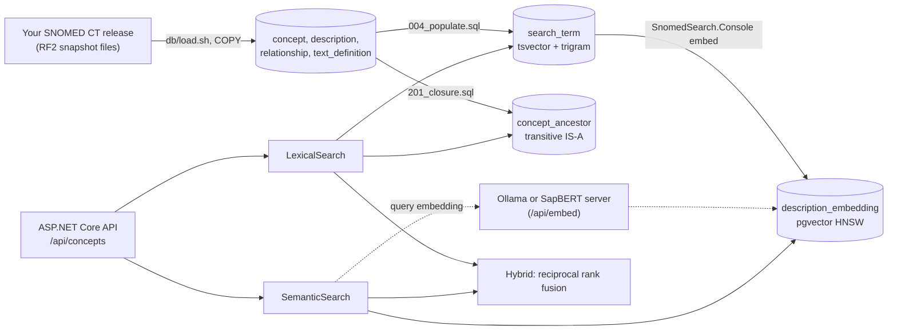

# SNOMED CT search

A .NET 10 and PostgreSQL service for finding SNOMED CT concepts from what people actually type:
word-order independent autocomplete, typo tolerance, optional embedding search, and hierarchy queries
for building value sets.

## The problem

SNOMED CT has about 380,000 active concepts and well over a million descriptions. A clinician typing
"chest pa" wants *Chest pain* first, not one of the dozens of longer terms that also contain those words.
A patient-facing form gets "the runs" or "can't poop", which share no words with *Diarrhea* or *Constipation*.
And a report often needs "everything under *Heart disease*", which means walking the IS-A hierarchy, not
matching text.

This service handles all three:

- **Lexical search and suggest:** every word must match the start of a word in a term, in any order.
  Results rank exact, then prefix, then the rest, with a typo-tolerant fallback.
- **Semantic and hybrid search (optional):** pgvector nearest-neighbour search over description embeddings,
  fused with the lexical ranking by reciprocal rank fusion.
- **Hierarchy:** parents, children, all ancestors, all descendants, and a `within=` filter that restricts
  any search to a subtree.

## Architecture



| Project | Role |
|---|---|
| `src/SnomedSearch.Api` | HTTP API, validation, problem-details errors, Swagger in Development |
| `src/SnomedSearch.Core` | Entities, request and response models, repository interface |
| `src/SnomedSearch.Infrastructure` | Lexical search, semantic search, embedding backfill, EF Core and raw SQL |
| `src/SnomedSearch.Console` | CLI: interactive `search`, `embed` backfill, `eval`, `bench` |
| `db/` | Idempotent SQL, loader, migration and query-plan scripts |
| `tests/` | xUnit tests against a real Postgres, synthetic RF2 fixture, golden queries |
| `tools/embed-server` | SapBERT served over the same protocol as Ollama |

## Getting started

You need Docker, the .NET 10 SDK, and a SNOMED CT release you are licensed to use (see Licensing).
On Windows, run the `db/*.sh` scripts from Git Bash or WSL.

```sh
cp .env.example .env              # then set a password
make up                           # Postgres 17 with pgvector, on 127.0.0.1:5433
make migrate                      # schema, extensions, tables, indexes
make load PATH_TO_RELEASE=/path/to/SnomedCT_InternationalRF2_PRODUCTION_...   # your download
dotnet run --project src/SnomedSearch.Api   # http://localhost:5091, Swagger at /swagger
```

`load` finds the snapshot files (`sct2_Concept_Snapshot*`, `sct2_Description_Snapshot-en*`,
`sct2_Relationship_Snapshot*`, `sct2_TextDefinition_Snapshot-en*`) anywhere under the folder you pass. It
replaces any previous load, builds the semantic tag table, the search table and the closure table, and runs
`ANALYZE`. On the International Edition used for the numbers below, building the search table took 47 s and
the closure table 2 min 01 s (single runs on an M1 Pro).

The app stops at startup and names any missing `SNOMED_DB_*` variable. There are no built-in credentials.

To enable semantic and hybrid search, follow `docs/semantic-search-runbook.md`.

## API

All endpoints are under `/api/concepts`. Errors are `application/problem+json`.

| Endpoint | Purpose |
|---|---|
| `GET search?q=&mode=lexical\|semantic\|hybrid&tags=&within=&limit=&page=&cursor=` | Search. Keyset `cursor` for deep paging; `page` is capped at 10,000 results |
| `GET suggest?q=&tags=&within=&limit=` | Autocomplete while typing. No count, no typo fallback, up to 20 |
| `GET {id}` | Details: FSN, preferred term, synonyms, definition, parents, child count |
| `GET {id}/children?limit=` and `{id}/parents` | Direct IS-A neighbours |
| `GET {id}/descendants?tags=&limit=&after=` | All descendants, keyset paged by id, with shortest depth |
| `GET {id}/ancestors` | All ancestors, nearest first |
| `GET {id}/synonyms` | Active synonyms |
| `GET semantic-tags` | Concept count per searchable semantic tag |

### Examples

These are real responses, from the API running against the **synthetic test fixture**
(`tests/fixtures/rf2`, invented ids and terms), so no licensed content is reproduced here.
Fields that are null on every item are omitted for space.

Word order does not matter, and the exact term ranks first:

```http
GET /api/concepts/search?q=nibble pain&limit=2
```
```json
{
  "items": [
    { "conceptId": 9200001, "preferredTerm": "Nibble ache", "semanticTag": "finding",
      "childrenCount": 2, "matchedTerm": "Nibble pain", "hasChildren": true },
    { "conceptId": 9200002, "preferredTerm": "Throbbing nibble pain", "semanticTag": "finding",
      "childrenCount": 0, "matchedTerm": "Nibble pain, throbbing", "hasChildren": false }
  ],
  "totalCount": 3,
  "nextCursor": "eyJLIjoiayIsIlIiOjEsIkwiOjIyLCJUIjoiTmliYmxlIHBhaW4sIHRocm9iYmluZyIsIkMiOjkyMDAwMDIsIk8iOjB9",
  "mode": "lexical",
  "fuzzy": false
}
```

A typo with no word match falls back to trigram similarity, and says so:

```http
GET /api/concepts/search?q=frabjus ache&limit=1
```
```json
{
  "items": [
    { "conceptId": 9200004, "preferredTerm": "Frabjous ache", "semanticTag": "finding",
      "childrenCount": 1, "matchedTerm": "Frabjous ache", "hasChildren": true }
  ],
  "totalCount": 1, "nextCursor": null, "mode": "lexical", "fuzzy": true
}
```

All descendants that are disorders, for a value set:

```http
GET /api/concepts/9000001/descendants?tags=disorder&limit=2
```
```json
{
  "conceptId": 9000001,
  "items": [
    { "conceptId": 9100001, "preferredTerm": "Quillon disease", "semanticTag": "disorder",
      "childrenCount": 2, "depth": 1, "hasChildren": true },
    { "conceptId": 9100002, "preferredTerm": "Acute quillon disease", "semanticTag": "disorder",
      "childrenCount": 0, "depth": 2, "hasChildren": false }
  ],
  "totalCount": 5,
  "nextAfter": 9100002
}
```

Search restricted to a subtree (9200002 is the only descendant of 9200004 that matches):

```http
GET /api/concepts/search?q=pain&within=9200004
```
```json
{
  "items": [
    { "conceptId": 9200002, "preferredTerm": "Throbbing nibble pain", "semanticTag": "finding",
      "childrenCount": 0, "matchedTerm": "Throbbing nibble pain", "hasChildren": false }
  ],
  "totalCount": 1, "nextCursor": null, "mode": "lexical", "fuzzy": false
}
```

## How ranking works

**Lexical.** The query is split into words (letters and digits only; everything else is a separator,
so `%`, `_` and tsquery operators cannot change the query). Each word becomes a prefix term, and all must
match the generated `tsvector` of a description (`to_tsvector('simple', term)`, GIN index). Matching
descriptions get a rank:

1. the whole term equals the query,
2. the term starts with the query,
3. everything else.

Within a rank, shorter terms come first, then alphabetical, then concept id. Each concept appears once,
with its best-ranked description as `matchedTerm`. The same query builder serves search, paging and
suggest, so the order is identical everywhere.

**Typo fallback.** Only when the word match finds nothing at all, `pg_trgm` word similarity (`<%`,
threshold 0.5, GIN trigram index) finds terms containing something close to the query. A cursor
remembers which of the two produced it, so a page past the end of the word results is empty instead
of switching to unrelated fuzzy matches.

**Semantic.** The query is embedded (and cached), then the nearest descriptions by cosine distance come
from a per-model HNSW index. pgvector's iterative scan keeps tag and subtree filters from starving the
result. Each concept is represented by its closest description.

**Hybrid.** The lexical and semantic top lists are fused with reciprocal rank fusion,
score = Σ 1 / (k + rank), with k = 60 by default. A concept that both methods find ranks above one that
only one finds. `k` and both candidate counts are configurable (`Hybrid__RrfK`, `Hybrid__LexicalCandidates`,
`Hybrid__SemanticCandidates`).

**Preferred term.** The shortest active synonym, then alphabetical. This is a heuristic (see Limitations).

## Evaluation

54 everyday phrases mapped to the concept a clinician would code (`eval/pairs.csv`, concept ids only).
Produced by `dotnet run --project src/SnomedSearch.Console -- eval`; full output with per-phrase ranks in
`docs/evaluation.md`.

### lexical-only

- Date: 2026-11-05 (UTC)
- Pairs: 54 from `eval/pairs.csv`; tag filter: finding, disorder; top 10 retrieved
- Data: 546,786 searchable descriptions
- Machine: macOS 27.0.1, 10 logical CPUs, Apple M1 Pro, 16 GB RAM, PostgreSQL 18.3 on the same machine
- Latency: wall time per query from the client to the database, after one warm-up query.

| Mode | Recall@1 | Recall@5 | Recall@10 | MRR@10 | p50 ms | p95 ms |
|---|---|---|---|---|---|---|
| lexical | 0.39 | 0.43 | 0.43 | 0.40 | 10.7 | 80.0 |

Semantic and hybrid rows are not here yet: they need an embedding model run (`docs/semantic-search-runbook.md`).
Lexical search misses most lay phrases ("the runs", "can't poop"), which is the gap semantic search is for.

## Benchmarks

Produced by `dotnet run -c Release --project src/SnomedSearch.Console -- bench` against the API running in
Release mode; full output in `docs/benchmarks.md`. Query plans for every main query are in `docs/query-plans.md`.

### m1pro-local

- Date: 2026-11-05 (UTC)
- Data: 378,553 active concepts, 546,786 searchable descriptions, 0 stored embeddings
- Machine (load generator): macOS 27.0.1, 10 logical CPUs, Apple M1 Pro, 16 GB RAM; API (Release, Production) and PostgreSQL 18.3 on the same machine as the load generator
- Method: closed loop, each of `c` workers sends its next request when the previous one returns. 5 s warm-up (not recorded), then 20 s measured per row. Search cycles through 54 phrases from `eval/pairs.csv` (limit 20); suggest cycles through 468 typed prefixes of them (limit 8). Latency is client-side wall time including HTTP.

| Endpoint | Concurrency | Requests | Req/s | p50 ms | p95 ms | p99 ms | Errors |
|---|---|---|---|---|---|---|---|
| suggest | 1 | 5,825 | 291.2 | 1.9 | 9.5 | 14.2 | 0 |
| suggest | 16 | 53,229 | 2658.9 | 3.5 | 18.7 | 31.2 | 0 |
| lexical | 1 | 960 | 47.9 | 11.6 | 62.8 | 145.6 | 0 |
| lexical | 16 | 8,280 | 412.1 | 20.4 | 121.2 | 282.4 | 0 |

Everything ran on one laptop, so the load generator competes with the API and the database for CPU.
Semantic and hybrid were not benchmarked (no embeddings stored).

## Tests and CI

```sh
make test     # or: dotnet test src/SnomedSearch.slnx
```

The tests start a pgvector Postgres with Testcontainers (Docker is the only requirement), apply the
repository's own SQL, and load the synthetic RF2 fixture with the same `COPY` path as the real loader.
To use a Postgres you already run instead, set `SNOMED_TEST_PG_ADMIN` to a connection string that can
create databases. They cover word order, prefix ranking, typo fallback, inactive concepts and descriptions,
tag and subtree filters, keyset paging, the page-past-the-end regression, hierarchy and closure, golden
queries (`tests/SnomedSearch.Tests/golden/lexical.json`), the embedding backfill, semantic and hybrid
search (with a deterministic test-only embedding client), and the embedding client's retry policy.

GitHub Actions (`.github/workflows/ci.yml`) restores, checks formatting and shell scripts, builds and tests.
It uses no secrets and no SNOMED data.

## Configuration

| Variable | Meaning |
|---|---|
| `SNOMED_DB_HOST`, `_PORT`, `_NAME`, `_USER`, `_PASSWORD` | Required. The app refuses to start without them |
| `SNOMED_DB_SCHEMA` | Schema with the tables (default `snomed`) |
| `Search__WordSimilarityThreshold` | Typo fallback threshold (default 0.5) |
| `Embedding__BaseUrl`, `Embedding__Model`, `Embedding__QueryPrefix` | Enables semantic and hybrid modes |
| `Semantic__EfSearch`, `Semantic__Candidates` | HNSW search breadth and candidate count |
| `Hybrid__RrfK`, `Hybrid__LexicalCandidates`, `Hybrid__SemanticCandidates` | Fusion settings |

Which semantic tags are searchable is data, not code: edit the `search_config` table and re-run
`db/sql/004_populate.sql`.

## Limitations

- **Preferred term is a heuristic.** No language reference set is loaded, so "preferred" means the
  shortest active synonym. Sometimes that is a technical synonym rather than the term a given country
  prefers (for example a Greek-derived term instead of the plain English one).
- **Word prefixes, not substrings.** "ache" does not match "headache". This keeps every query on an index;
  the typo fallback covers some of the gap.
- **The typo fallback runs only on zero word matches.** A query with one correct and one misspelt word that
  still matches something will not also get fuzzy results.
- **Semantic search is unmeasured.** The code and tests are complete, but no embedding model has been run on
  the real data yet, so there are no semantic recall or latency numbers. See `docs/embedding-choice.md`.
- **Semantic and hybrid results are not paged.** Raise `limit` (up to 100) instead.
- **Small evaluation set.** 54 phrases chosen by one person. Treat the recall figures as a regression check,
  not a general accuracy claim.
- **Benchmarks are from one laptop** with the client, API and database sharing it.
- **Only snapshot files** are loaded (no full or delta history), and only English descriptions.
- **The Testcontainers path has not run yet.** Locally the tests were run only against an existing
  Postgres (`SNOMED_TEST_PG_ADMIN`), because Docker was not running on the development machine. The first
  CI run will be the first run of the container path.

## Licensing

The code is MIT licensed (see `LICENSE`).

**SNOMED CT content is licensed separately and is not included here.** Get the release files from your
national release centre or SNOMED International under the terms that apply to you. This repository never
contains SNOMED data: the loader reads the folder you point it at, the tests use a synthetic fixture with
invented ids and terms, and `eval/pairs.csv` contains concept ids only.
